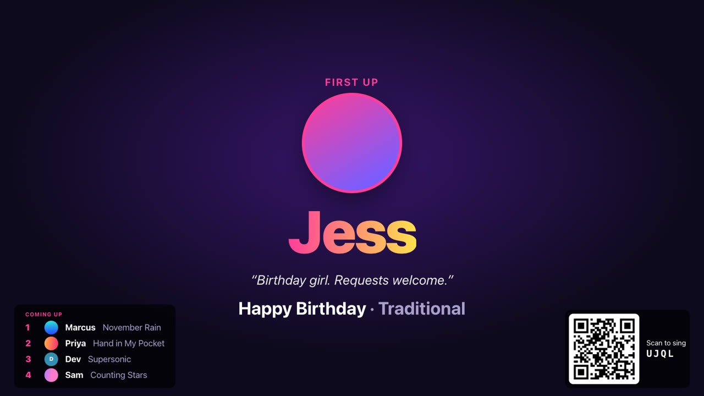
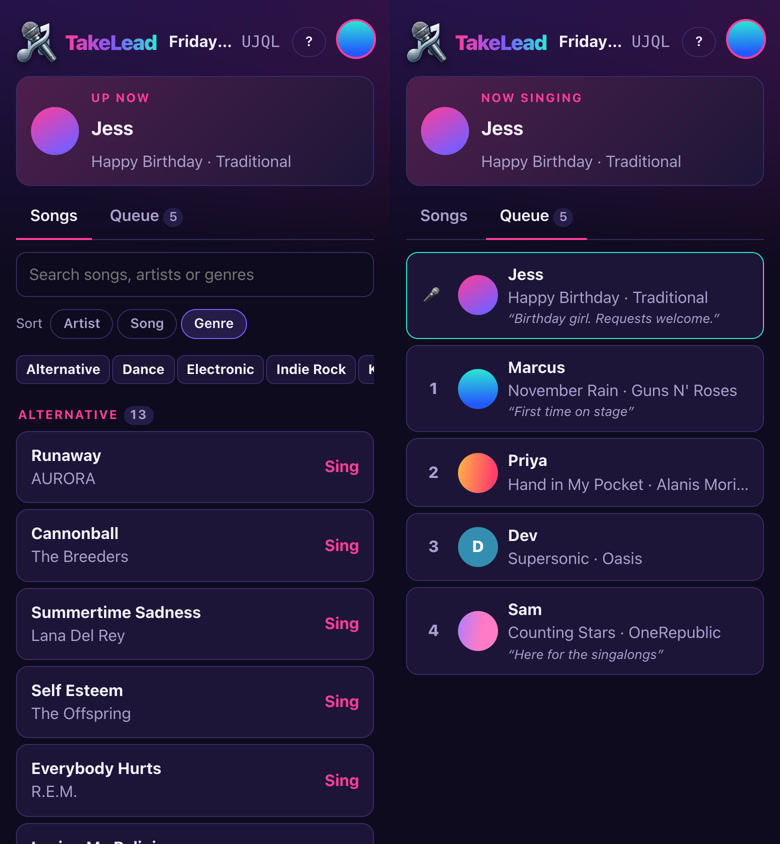
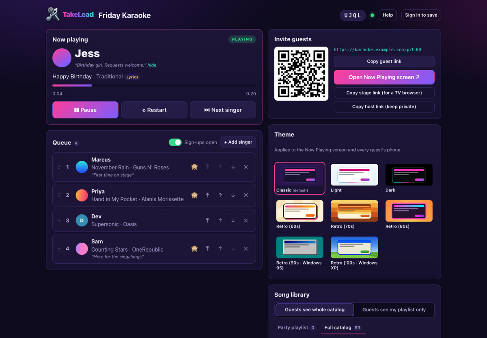
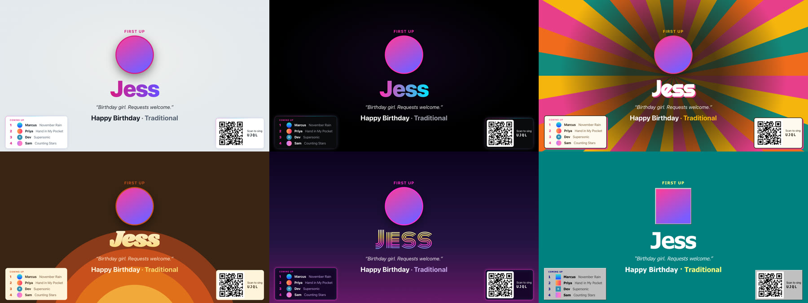
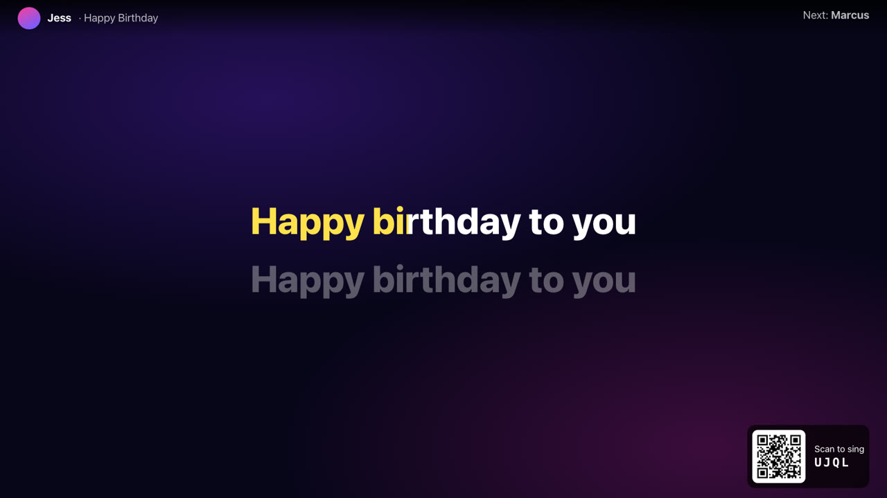

<p align="center">
  
</p>

<h1 align="center">TakeLead</h1>

<p align="center">
  A karaoke party app. Guests scan a QR code, pick a song on their phone and join the queue.<br />
  The TV shows who's up next and plays their song.
</p>

<p align="center">
  <a href="LICENSE"></a>
  
  
</p>

<p align="center">
  
</p>

## How a party works

1. The host creates a party and opens the **Now Playing** screen on a TV.
2. Guests scan the QR code. There's nothing to install and no account to make.
3. Each guest picks a song and joins the queue. They can add a photo and a line about themselves.
4. When it's someone's turn, the TV shows their name and waits. The host presses Play when they have the mic.

<p align="center">
  
</p>

The host runs everything from a dashboard: playback, the queue order, the song list, the theme and invites.

<p align="center">
  
</p>

## Features

- **Songs from YouTube or your own files.**
  - Paste a YouTube video or a whole playlist.
  - Or drop karaoke videos, or audio with `.lrc` lyrics, into a folder.
  - For audio tracks, the app draws the lyrics itself and highlights each word as it's sung.
- **A song list that's easy to browse.**
  - Sort by artist, song or genre. Genres are looked up automatically, and the host can correct them.
  - Hosts can open the whole catalog to guests or limit them to a party playlist.
- **Fair sign-ups.**
  - Each song can be in the queue once.
  - Names are unique within a party.
  - Guests can cancel their own sign-ups; the host can reorder or remove any of them.
- **Guest profiles.** A photo and a short line about themselves, shown on the TV when it's their turn. The host can remove either.
- **Eight themes:** Classic, Light, Dark, and retro 60s, 70s, 80s, Windows 95 and Windows XP. The theme applies to the TV and every guest's phone.
- **Optional host accounts.**
  - Saved parties and playlists, and hosting from any device.
  - Password reset by email.
- **Built-in help** for guests and hosts.

<p align="center">
  
</p>

<p align="center">
  
</p>

## Quick start

You need [Node.js](https://nodejs.org) 22.13 or newer.

```bash
git clone https://github.com/scooterhanson/TakeLead.git
cd TakeLead
npm install
npm run dev
```

Open http://localhost:5173 and create a party. Three public-domain demo songs are included, so you can try it right away. Phones on the same Wi-Fi can scan the QR code to join.

To run it for real, on a home computer or a server with your own domain, see **[DEPLOY.md](DEPLOY.md)**.

| Command | What it does |
|---|---|
| `npm run dev` | Development server with live reload |
| `npm run build` | Type-check and build the web app |
| `npm start` | Run the built app on port 3000 |
| `npm run backup` | Copy the database and guest photos to `backups/` |
| `npm run package` | Build a release archive in `release/` |
| `npm run demo-songs` | Regenerate the demo songs |

Settings live in `.env`. See [`.env.example`](.env.example).

## Song sources

| Source | How to add | Notes |
|---|---|---|
| YouTube | Paste a video or playlist link in **Song library → Add songs** | Playlists must be public or unlisted. Videos whose owners block playback on other sites are skipped. Ads may play unless the TV's browser has YouTube Premium. |
| Audio + lyrics | `Artist - Title.mp3` and `Artist - Title.lrc` in `media/` | Lyrics are highlighted word by word if the LRC file has word timings. Free synced lyrics: [lrclib.net](https://lrclib.net). |
| Karaoke videos | `Artist - Title.mp4` or `.webm` in `media/` | Lyrics must be part of the video. |

Most commercial karaoke tracks are copyrighted. YouTube links and files you own are fine for private parties; public or paid events need proper licensing.

## How it's built

- **Server:** Node.js, Express and Socket.IO, with SQLite through Node's built-in `node:sqlite`. No separate database server is needed.
- **Web app:** React and Vite.
- **Shared state:** the server holds the queue and playback state and sends every change to all screens in real time. The TV reports progress and song endings back, and only the host and TV can control playback.

```
server/     API, real-time updates, accounts, guest profiles, song catalog
src/        the web app: home, host dashboard, guest page, TV screen, help
deploy/     service files for macOS and Linux, Cloudflare Tunnel example
scripts/    demo songs, backup, packaging
```

## Contributing

Bug reports and pull requests are welcome. For anything bigger than a small fix, open an issue first to talk it over.

Ideas that would fit well: CD+G playback, uploading song files from the dashboard, YouTube search inside the app, duets, and fairer queue rotation.

## License

Copyright (C) 2026 Scooter Hanson

TakeLead is free software: you can redistribute it and/or modify it under the terms of the [GNU Affero General Public License](LICENSE), version 3 or later. If you run a modified version as a network service, you must make your modified source code available to its users.

The demo songs in `media/Public Domain Demos` are traditional, public-domain melodies, synthesized for this project.
